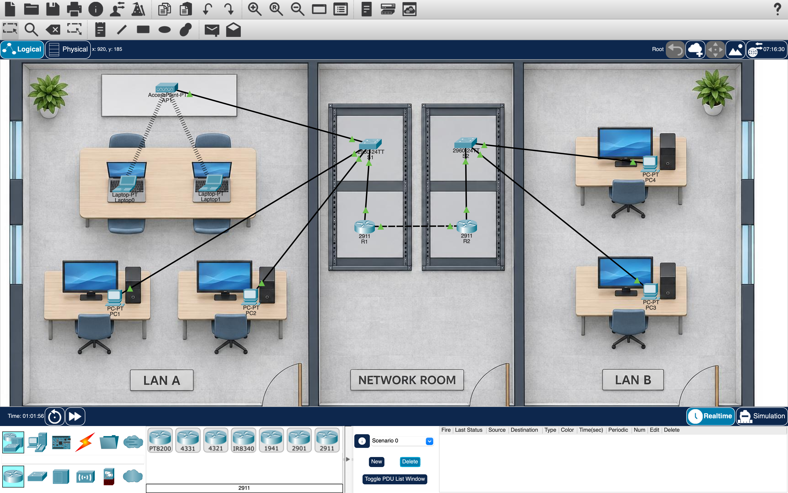
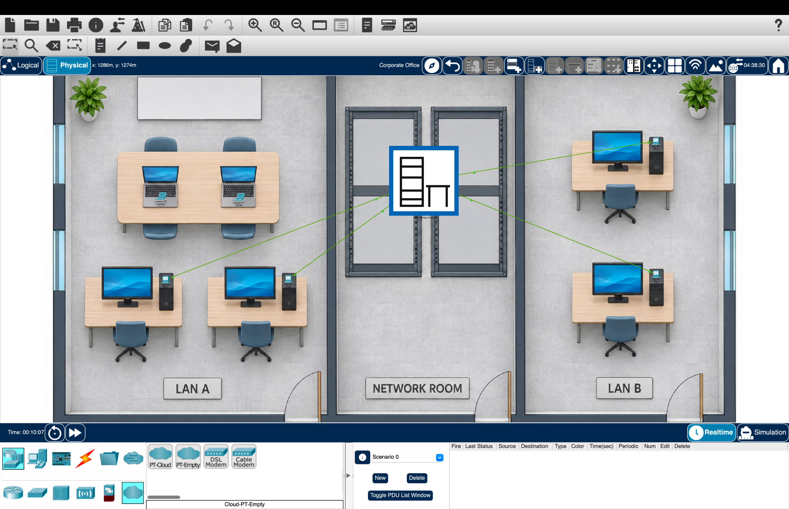
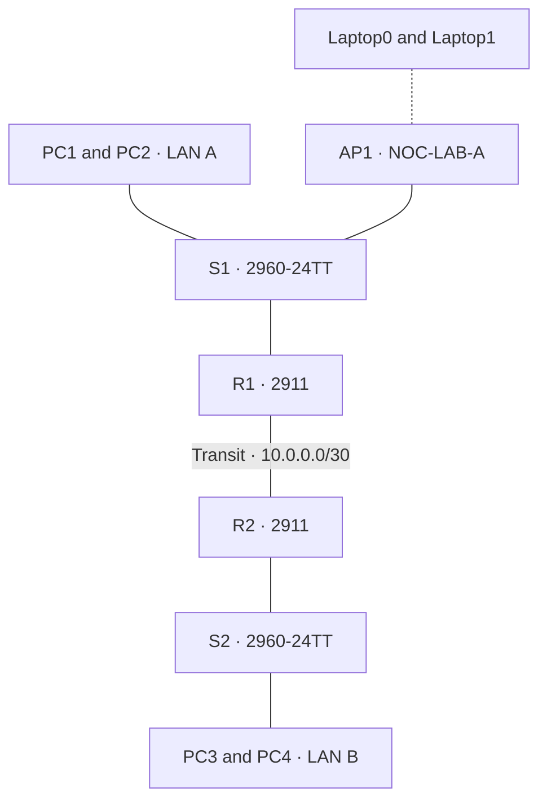

# Cisco Packet Tracer NOC Lab

I built this network operations lab in Cisco Packet Tracer to practice IPv4 addressing, DHCP, static routing, and wired and wireless connectivity. I simulated three faults and documented how I diagnosed and resolved each one.

**[Download the Packet Tracer lab (.pkt)](https://github.com/ZebrikDev/cisco-packet-tracer-noc-lab/raw/refs/heads/main/noc-network-lab-final.pkt)** · [Troubleshooting cases](#troubleshooting-cases) · [Router configurations](configs/README.md)

## Topology

The network uses two Cisco 2911 routers, two Cisco 2960-24TT switches, four wired PCs, two wireless laptops, and one AccessPoint-PT. PC1 and PC2 share LAN A with both laptops. PC3 and PC4 are in LAN B. R1 and R2 connect the LANs over a dedicated transit subnet. AP1 bridges the laptops on the `NOC-LAB-A` SSID to S1.

Physical workspace and floor plan

[View the source floor plan](assets/physical-floor-plan.png).

Network diagram

The dotted connection represents Wi-Fi. The other connections are Ethernet links.

## IPv4 addressing

| Segment or interface | Address or range | Role |
|---|---|---|
| LAN A | `192.168.10.0/24` | PC1, PC2, Laptop0, Laptop1 |
| R1 GigabitEthernet0/0 | `192.168.10.1/24` | LAN A gateway and local DHCP server |
| LAN A DHCP range | `192.168.10.100–192.168.10.199` | Dynamic client addresses |
| Transit | `10.0.0.0/30` | Ethernet link between the routers |
| R1 GigabitEthernet0/1 | `10.0.0.1/30` | R1 transit interface |
| R2 GigabitEthernet0/1 | `10.0.0.2/30` | R2 transit interface |
| LAN B | `192.168.20.0/24` | PC3 and PC4 |
| R2 GigabitEthernet0/0 | `192.168.20.1/24` | LAN B gateway and local DHCP server |
| LAN B DHCP range | `192.168.20.100–192.168.20.199` | Dynamic client addresses |

Lease addresses can change. PC1 was observed at `192.168.10.101/24` with gateway `192.168.10.1` in the final validation capture. The destination of that test was PC3 at `192.168.20.100`. PC1 used `192.168.10.50/24` temporarily in the separate incident 003 exercise.

## Configuration

Each router serves DHCP for its directly connected LAN. The lower and upper exclusion ranges reserve all usable addresses outside the intended `.100–.199` pool range. Each LAN uses its router as the default gateway.

| Router | Destination | Next hop |
|---|---|---|
| R1 | `192.168.20.0/24` | `10.0.0.2` |
| R2 | `192.168.10.0/24` | `10.0.0.1` |

The [configuration reference](configs/README.md) links to the original CLI captures and the transcribed running configuration excerpts for [R1](configs/R1-running-config.txt) and [R2](configs/R2-running-config.txt).

## Verification

| Check | Observed result | Evidence |
|---|---|---|
| Router transit | R1 received 5/5 replies from `10.0.0.2` | [Transit ping](screenshots/incident-002-transit-ping.png) |
| LAN A DHCP | Two wired client leases shown during initial setup | [DHCP bindings](screenshots/lan-a-dhcp-bindings.png) |
| Wireless association | Both laptops linked to AP1 | [Wi-Fi topology](screenshots/wi-fi-associations.png) |
| Wireless IPv4 and connectivity | I verified DHCP and pinged the local gateway and a remote host from both laptops | Lab observation |
| PC1 to LAN B | `tracert` reached the destination through `192.168.10.1` and `10.0.0.2` | [Two-router trace](screenshots/tracert-two-routers.png) |
| Final PC1 to PC3 | First attempt 2/4 replies, immediate repeat 4/4 and 0% loss | [Final cross-LAN ping](screenshots/final-cross-lan-ping.png) |

The initial unanswered probes appear in the original capture. Their cause was not verified.

## Troubleshooting cases

| Incident | Finding | Recovery |
|---|---|---|
| [001 · Disabled LAN interface](incidents/incident-001-administratively-down.md) | R1 G0/0 was administratively down. Transit remained reachable. | Enabled G0/0 and verified remote reachability. |
| [002 · Missing static routes](incidents/incident-002-missing-static-routes.md) | R1 lacked the route to LAN B. Investigation also found R2's return route missing. | Restored both routes and verified end-to-end connectivity. |
| [003 · Incorrect default gateway](incidents/incident-003-incorrect-default-gateway.md) | PC1 could reach its own subnet but lost remote reachability after its default gateway changed. | Corrected the gateway and verified 4/4 replies from PC3. |

I reproduced each fault in a working copy of the lab. Each report documents the impact, diagnostic evidence, root cause, repair, and verification.

## Command reference

| Where | Command | Purpose |
|---|---|---|
| IOS | `show ip interface brief` | Check interface addresses and status |
| IOS | `show ip route` | Check connected routes and both static next hops |
| IOS | `show running-config` | Review the active router configuration |
| IOS | `show ip dhcp pool` / `show ip dhcp binding` | Check pools and client leases |
| IOS | `copy running-config startup-config` | Save the router's startup configuration |
| PC-PT | `ipconfig` / `ping` / `tracert` | Verify host addressing, reachability, and the routed path |

## Opening the lab

The lab was built in Cisco Packet Tracer 9.0.0.0810 on macOS.

1. Open [noc-network-lab-final.pkt](noc-network-lab-final.pkt) in Cisco Packet Tracer.
2. Select **Logical** for topology and CLI access or **Physical** for the office layout.
3. In **Realtime** mode, run `ipconfig` on PC3, then ping its current IPv4 address from PC1.
4. If you change a router configuration, save the startup configuration and the project file.

## Learning outcomes and limitations

- Built and documented a routed two-LAN network with DHCP and a wireless access point.
- Used host, interface, and route evidence to distinguish three faults and verify recovery.
- Recorded the scope of each check and retained original screenshots.
- Results describe a Packet Tracer simulation. Timing values are simulator output. Internet access and production monitoring are outside the lab scope.
